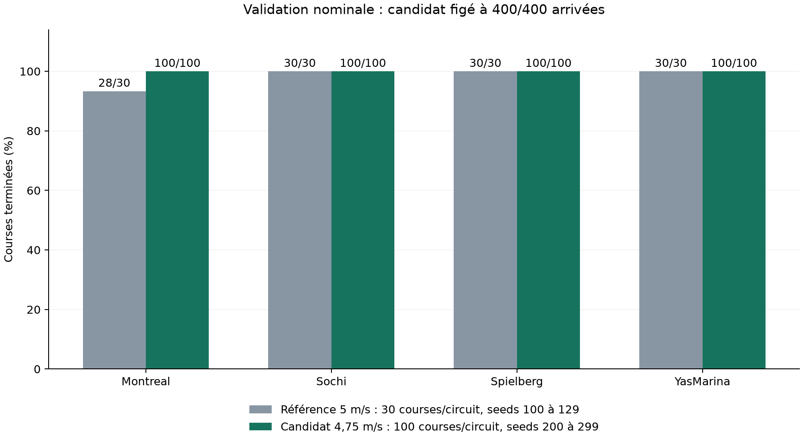

# driver1 : 400/400 courses finies en validation nominale

> **Remplacé le 2026-11-12 par le modèle E-23** ([résultats](../e-23/README.md)). Cette
> page reste la trace du modèle précédent.

Le pilote réactif de `submission/driver1` finit **400/400 courses nouvelles** sur
Montreal, Sochi, Spielberg et YasMarina, après 132/132 cas de sélection : trois tours,
départ officiel, conditions nominales, 8000 décisions au plus. DNF et TIMEOUT comptent.



## Du réactif E-18 au livrable

Chaque étape est décrite avant d'être mesurée. Les seeds de course ne sont pas des
entraînements indépendants : le taux décrit ces quatre cartes en nominal.

| Étape | Validation nominale | Ce qui change |
|---|---:|---|
| Réactif E-18, seed 0 | 7/12 | Point de départ, 5 007 360 interactions |
| Adaptation, plafond 5 m/s | 10/12 | +2 027 520 interactions sur les 15 cartes train, optimiseur neuf |
| Départs train diversifiés | 10/12 | Waypoint aléatoire, ±0,2 m latéral, ±0,1 rad de cap |
| Connexions de progression retirées | 12/12 | Colonnes 102 à 104 à zéro dans la première couche, sans interaction |
| Même modèle, seeds 100 à 129 | 118/120 | Confirmation ; 2 DNF à Montreal (seeds 104 et 118) |
| Plafond d'inférence 4,75 m/s | 132/132 | Mêmes 13 tenseurs appris ; borne de vitesse 0,1667 → 0,125 |
| Agent ONNX figé, seeds 200 à 299 | **400/400** | Confirmation, 100/100 par carte |

- **Plafond seul** : sans réentraînement, aucun plafond de 10 à 4 m/s ne fait finir
  les quatre circuits.
- **Ablation** : `scripts/ablate_progress.py` met à zéro, dans l'acteur et le critique,
  les connexions depuis le sinus et le cosinus de progression et les tours accomplis.
  Un contrôle sur 256 entrées compare au modèle source avec ces entrées masquées.
- **Calibration** : les deux DNF de Montreal sont reproduits avec l'agent ONNX. Le plus
  haut plafond global qui les corrige, 4,75 m/s, est retenu sur les 132 anciens cas,
  sans réglage par circuit ni par seed (`speed-diagnostic.json`,
  `calibration-proof.json`).
- **Confirmation** : l'agent est figé par ses hashes (`candidate-freeze.json`) avant la
  première course nouvelle, puis lancé par `scripts/confirm_submission.py` dans l'image
  CPU du tournoi, sans PyTorch ni Stable-Baselines3. Les hashes sont identiques après
  les 400 courses (`confirmation-400.json`).

## Coût et limites

- **Chrono** : sur les 118 courses finies par les modèles à 5 et 4,75 m/s, le temps
  médian passe de 236,17 à 247,57 s (`time-comparison.json`). Sur les 7 courses finies
  par le réactif E-18, le modèle à 5 m/s passait déjà de 120,65 à 203,00 s.
- **Météo** : la campagne de 105 cas (`full-campaign-105.json`) garde 45/45 sur train
  et 12/12 en nominal, bruit LiDAR et marge stricte, mais **6/12** sous faible adhérence
  et forte pluie, à une friction de 0,5 que le sujet v1.3.0 n'utilise pas (plage de 0,7
  à 1,0). À 0,7, avec ou sans bruit de 0,1, il finit **9/12** et Montreal échoue sur ses
  trois seeds (`weather-v1.3.0.json`). La météo y reste constante, alors qu'au tournoi
  elle change en pleine course : suite dans E-23.
- Les circuits test restent scellés.

## Provenance et reproduction

Les fichiers `.json` cités sont dans l'artefact W&B `results-driver1` : `SHA256SUMS` donne
sa version et l'empreinte de chaque fichier ([récupération](../../experiments.md#résultats-bruts)).

| Modèle | Manifest |
|---|---|
| Entraînement source, plafond 5 m/s, départs diversifiés | [cap5-random-h1-seed0-2m](manifests/cap5-random-h1-seed0-2m.json) |
| Ablation, 5 m/s, 118/120 (`confirmation-5mps-120.json`) | [cap5-progress-blind](manifests/cap5-progress-blind.json) |
| Livrable, 4,75 m/s, `4956e2a9…` | [cap4.75-progress-blind](manifests/cap4.75-progress-blind.json) |
| Poids adversaires à zéro, mêmes courses seul en piste (remplacé par E-23) | [driver1](../opponent-weights/manifests/driver1.json) ([preuves](../opponent-weights/README.md)) |

La preuve de livraison (`submission-proof.json`) relie le modèle aux courses :
vérificateur officiel valide, écart ONNX/PyTorch de 4,77 × 10⁻⁷ sur 256 entrées.
Archives de la station : `/home/leo/runs/crashlearn/e19-20261110` (entraînements,
checkpoints, logs) et `/home/leo/runs/crashlearn/e19-100-20261110` (calibration).

```bash
uv run python scripts/ablate_progress.py --max-speed 4.75 \
  --run-dir /home/leo/runs/crashlearn/e19-20261110/cap5-random-h1-seed0 \
  --output-dir runs/recheck-driver1
uv run python scripts/export_agent.py --run-dir runs/recheck-driver1 \
  --output-dir runs/recheck-driver1-agent
docker run --rm --user "$(id -u):$(id -g)" \
  -v "$PWD:/workspace:ro" -v "$PWD/runs:/runs" -w /tmp \
  -e PYTHONPATH=/workspace/src -e NUMBA_CACHE_DIR=/runs/numba-cache-cpu \
  crashlearn-sim:20260918 python /workspace/scripts/confirm_submission.py \
  --submission /workspace/submission/driver1 \
  --output /runs/recheck-confirmation.json --seed-start 200 --seed-count 100
```
