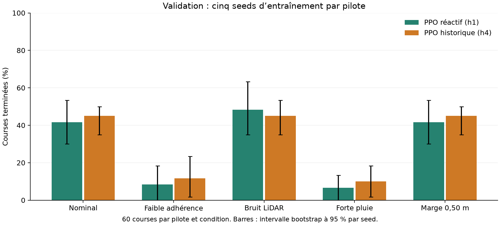

# E-18 : la mémoire aide-t-elle driver2 ?

Un PPO qui décide sur ses 4 dernières observations (`ppo-h4`, 504 entrées) est
comparé à un PPO réactif identique (`ppo-h1`, 126 entrées). Le pilote scripté
d'E-11 sert de témoin de la mesure. Le protocole a été figé avant la campagne
(memlog du 30/10 et du 01/11).

**Conclusion sur la validation nominale : non concluant.** Avec cinq seeds,
l'intervalle reste large ; cela ne prouve pas que la mémoire est inutile.

## Protocole

- **Entraînement** : seeds 0 à 4 pour h1 et h4, même `PPO_CONFIG`
  (`[256, 256]`, `log_std_init = -1`), 5 007 360 interactions chacun, 15 workers
  fixés sur les 15 circuits train, RTX 5070. Modèle de fin de budget, sans
  sélection du meilleur checkpoint.
- **Évaluation** : politique déterministe, 3 tours, 8000 décisions au plus,
  seeds 0 à 2, soit 105 courses par modèle. Le test scellé n'est jamais utilisé.

| Condition | Friction | Bruit LiDAR | Circuits |
|---|---:|---:|---|
| `nominal` | Officielle | Officiel | 15 train + 4 validation |
| `low_friction` | 0,5 | Officiel | 4 validation |
| `lidar_noise` | Officielle | 0,1 | 4 validation |
| `heavy_rain` | 0,5 | 0,1 | 4 validation |
| `strict_margin` | Officielle | Officiel | 4 validation, marge de sortie de 0,50 m |

Friction 0,5 et bruit 0,1 sont les bornes « forte pluie » du simulateur. Le sujet
v1.3.0 donne la plage du tournoi : friction de 0,7 à 1,0, bruit de 0,001 à 0,1, avec des
changements pendant la course. La friction 0,5 est donc plus basse que toute friction du
tournoi, mais la campagne garde une météo constante pendant chaque course.
`strict_margin` applique la marge annoncée par `INSTRUCTIONS.md` au lieu du
1,00 m du code, pour qu'un pilote ne dépende pas d'une tolérance fragile.

**Critère de décision** : h4 moins h1 par seed d'entraînement, intervalle
bootstrap à 95 %. h4 est plus ou moins fiable si l'intervalle du taux d'arrivée
exclut 0 ; sinon plus rapide ou plus lent si celui du chrono exclut 0, sur les
seules courses finies par les deux ; sinon, ou avec moins de 3 seeds :
**non concluant**.

## Résultats

1 050 courses PPO et 105 courses du témoin, DNF et TIMEOUT compris. Les tables
ci-dessous viennent de `scripts/compare_drivers.py`, supprimé après la clôture
d'E-18 (dernière version au commit `23a289a`). Chaque course reste dans les
JSON de ce dossier (484 courses non finies sur 1 155).

### Résultats par pilote

| Pilote | Partition | Condition | Courses | Arrivées | Arrivées, moyenne par carte | Écart au nominal | DNF | TIMEOUT | Chrono médian (s) |
|---|---|---|---:|---:|---:|---:|---:|---:|---:|
| ppo-h1 | train | nominal | 225 | 76.9 % | 76.9 % | - | 52 | 0 | 148.60 |
| ppo-h1 | validation | nominal | 60 | 41.7 % | 41.7 % | - | 35 | 0 | 159.50 |
| ppo-h1 | validation | low_friction | 60 | 8.3 % | 8.3 % | -33.3 pts | 55 | 0 | 203.30 |
| ppo-h1 | validation | lidar_noise | 60 | 48.3 % | 48.3 % | +6.7 pts | 31 | 0 | 159.45 |
| ppo-h1 | validation | heavy_rain | 60 | 6.7 % | 6.7 % | -35.0 pts | 56 | 0 | 200.50 |
| ppo-h1 | validation | strict_margin | 60 | 41.7 % | 41.7 % | +0.0 pts | 35 | 0 | 159.50 |
| ppo-h4 | train | nominal | 225 | 93.8 % | 93.8 % | - | 14 | 0 | 146.95 |
| ppo-h4 | validation | nominal | 60 | 45.0 % | 45.0 % | - | 33 | 0 | 141.35 |
| ppo-h4 | validation | low_friction | 60 | 11.7 % | 11.7 % | -33.3 pts | 53 | 0 | 135.35 |
| ppo-h4 | validation | lidar_noise | 60 | 45.0 % | 45.0 % | +0.0 pts | 33 | 0 | 141.20 |
| ppo-h4 | validation | heavy_rain | 60 | 10.0 % | 10.0 % | -35.0 pts | 54 | 0 | 130.15 |
| ppo-h4 | validation | strict_margin | 60 | 45.0 % | 45.0 % | +0.0 pts | 33 | 0 | 141.35 |
| scripted | train | nominal | 45 | 100.0 % | 100.0 % | - | 0 | 0 | 196.75 |
| scripted | validation | nominal | 12 | 100.0 % | 100.0 % | - | 0 | 0 | 213.62 |
| scripted | validation | low_friction | 12 | 100.0 % | 100.0 % | +0.0 pts | 0 | 0 | 214.85 |
| scripted | validation | lidar_noise | 12 | 100.0 % | 100.0 % | +0.0 pts | 0 | 0 | 220.55 |
| scripted | validation | heavy_rain | 12 | 100.0 % | 100.0 % | +0.0 pts | 0 | 0 | 221.62 |
| scripted | validation | strict_margin | 12 | 100.0 % | 100.0 % | +0.0 pts | 0 | 0 | 213.62 |

### Comportement

Moyennes par course. Contacts par 100 m parcourus. Un saut de progression est un pas où le simulateur crédite plus d'1 m au-delà de la distance roulée, comme une coupe à travers un mur. L'écart crédité moins roulé est un peu positif pour une trajectoire qui coupe les virages, et très positif pour un raccourci.

| Pilote | Partition | Condition | Mur / 100 m | Voiture / 100 m | Immobile (pas) | Marche arrière (pas) | Variation des commandes | Sauts de progression | Crédité moins roulé (m) |
|---|---|---|---:|---:|---:|---:|---:|---:|---:|
| ppo-h1 | train | nominal | 0.32 | 0.00 | 33.6 | 3.5 | 0.0158 | 0.35 | +12.9 |
| ppo-h1 | validation | nominal | 7.18 | 0.00 | 83.7 | 18.5 | 0.0129 | 0.35 | +5.7 |
| ppo-h1 | validation | low_friction | 31.22 | 0.00 | 136.4 | 30.4 | 0.0135 | 0.17 | -1.7 |
| ppo-h1 | validation | lidar_noise | 6.17 | 0.00 | 86.4 | 20.2 | 0.0137 | 0.50 | +6.0 |
| ppo-h1 | validation | heavy_rain | 30.89 | 0.00 | 135.3 | 32.0 | 0.0148 | 0.12 | -1.9 |
| ppo-h1 | validation | strict_margin | 7.18 | 0.00 | 83.7 | 18.5 | 0.0129 | 0.35 | +5.7 |
| ppo-h4 | train | nominal | 0.58 | 0.00 | 9.3 | 3.0 | 0.0095 | 0.08 | +10.7 |
| ppo-h4 | validation | nominal | 8.04 | 0.00 | 75.4 | 27.6 | 0.0079 | 0.10 | +1.8 |
| ppo-h4 | validation | low_friction | 33.89 | 0.00 | 124.7 | 50.4 | 0.0089 | 0.00 | -5.7 |
| ppo-h4 | validation | lidar_noise | 8.38 | 0.00 | 72.8 | 26.2 | 0.0082 | 0.07 | +1.8 |
| ppo-h4 | validation | heavy_rain | 36.86 | 0.00 | 120.6 | 47.6 | 0.0096 | 0.02 | -5.3 |
| ppo-h4 | validation | strict_margin | 8.04 | 0.00 | 75.4 | 27.6 | 0.0079 | 0.10 | +1.8 |
| scripted | train | nominal | 0.00 | 0.00 | 1.0 | 0.0 | 0.0145 | 0.18 | +35.8 |
| scripted | validation | nominal | 0.00 | 0.00 | 1.0 | 0.0 | 0.0160 | 0.00 | +26.4 |
| scripted | validation | low_friction | 0.00 | 0.00 | 1.0 | 0.0 | 0.0144 | 0.00 | +22.3 |
| scripted | validation | lidar_noise | 0.00 | 0.00 | 1.0 | 0.0 | 0.0296 | 0.00 | +25.5 |
| scripted | validation | heavy_rain | 0.00 | 0.00 | 1.0 | 0.0 | 0.0280 | 0.00 | +22.1 |
| scripted | validation | strict_margin | 0.00 | 0.00 | 1.0 | 0.0 | 0.0160 | 0.00 | +26.4 |

### Apport de la mémoire : ppo-h4 moins ppo-h1

Intervalles bootstrap à 95 % par seed d'entraînement. Gain de chrono positif : ppo-h4 plus rapide, sur les courses finies par les deux pilotes.

| Partition | Condition | Seeds | Arrivées (pts) | Gain de chrono (s) | Conclusion |
|---|---|---:|---|---|---|
| train | nominal | 5 | [+2.2 ; +36.9] | [-0.1 ; +23.4] | h4 plus fiable |
| validation | nominal | 5 | [-15.0 ; +20.0] | [-1.2 ; +34.4] | non concluant |
| validation | low_friction | 5 | [-3.3 ; +10.0] | seeds insuffisantes | non concluant |
| validation | lidar_noise | 5 | [-26.7 ; +15.0] | [-1.3 ; +33.7] | non concluant |
| validation | heavy_rain | 5 | [-3.3 ; +11.7] | seeds insuffisantes | non concluant |
| validation | strict_margin | 5 | [-15.0 ; +20.0] | [-1.2 ; +34.4] | non concluant |

## Soumissions

La sélection maximise les finitions nominales de validation, puis retient la
plus petite seed ([hashes](selection/agents.json),
[preuve](selection/submission-proof.json)).

| Agent | Modèle | Arrivées nominales en validation |
|---|---|---:|
| `submission/driver2` | ppo-h4, seed 1 | 6/12 |
| ancien `driver1` | ppo-h1, seed 0 | 7/12, remplacé : voir [driver1](../driver1/README.md) |

## Provenance

- Commit d'entraînement `adf5a5f`, image
  `sha256:ff88d08af5fd4a202ba98f0b86f027af167df440efd027a79350eadd869e5df2`.
  Chaque hash de modèle et de prétraitement a été comparé à son manifest.
- Un redémarrage du serveur a interrompu `ppo-h1-seed4` ; sa tentative reste dans
  `manifests/ppo-h1-seed4-interrupted.json`. Une relance complète, à budget
  identique, fournit ses courses.
- Archive de la station : `/home/leo/runs/crashlearn/e18-20261109` (modèles,
  checkpoints, CSV, W&B hors ligne, code figé).
- Limites : solo seulement, perturbations jamais vues à l'entraînement (E-23).
