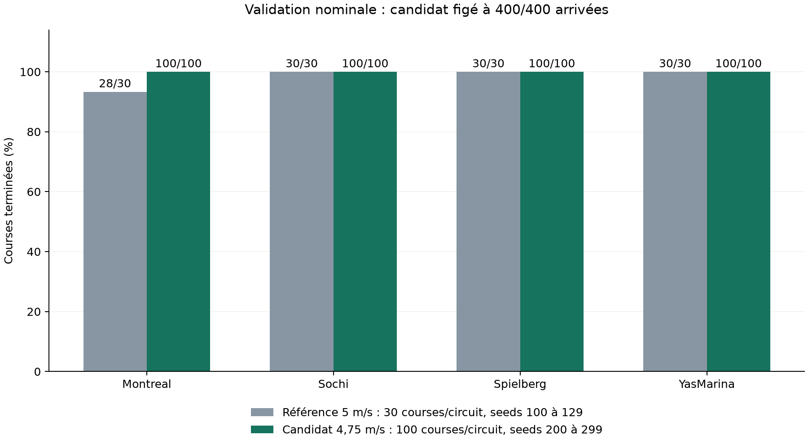

# Pilote réactif : 400/400 arrivées en validation nominale

Le `driver1` livré termine **400/400 courses nouvelles, soit 100 % observés**,
après 132/132 cas de sélection. Montreal, Sochi, Spielberg et YasMarina finissent
chacun à 100/100. Il n'y a aucun DNF ni TIMEOUT dans cette confirmation.



## Ce qui corrige les deux échecs

Le modèle précédent à 5 m/s finissait 118/120 courses. Ses deux DNF de Montreal,
seeds 104 et 118, sont reproduits à l'identique avec l'agent ONNX réel. Un plafond
global de 4,75 m/s permet de terminer ces courses, puis les 132 anciens cas.
Ce plafond s'applique de la même manière à tous les circuits et toutes les seeds.

Les **13 tenseurs appris sont identiques** à ceux du modèle précédent. La seule
différence de contrôle est la borne supérieure de vitesse : action normalisée
de `0,16666667` à `0,125`, soit de 5 à 4,75 m/s. L'ablation de progression reste
identique. Le modèle hérite du PPO entraîné sur GPU pour E-19 ; cette calibration
ajoute zéro interaction d'apprentissage. La [preuve de calibration](calibration-proof.json)
relie les deux modèles et contrôle leurs paramètres.

## Sélection et confirmation

Le [protocole](../../reliability_100.md) fixe la distinction avant sélection :

| Ensemble | Seeds de course par circuit | Arrivées | Rôle |
|---|---|---:|---|
| Anciennes courses nominales | 0 à 2 et 100 à 129 | 132/132 | Choix du plafond |
| Courses nouvelles | 200 à 299 | 400/400 | Confirmation du candidat figé |

Le [gel du candidat](candidate-freeze.json) précède la première course nouvelle.
Toutes ses empreintes sont inchangées après les 400 courses. Chaque paire
carte/seed est unique. Chaque arrivée contient trois temps de tour et une
progression d'au moins trois tours. Les limites restent celles du protocole :
départ officiel, conditions nominales et 8000 décisions au plus.

La confirmation utilise l'agent ONNX réel dans l'image CPU officielle, depuis
`/tmp`, sans importer PyTorch ni Stable-Baselines3. Le vérificateur officiel
valide l'artefact. Les [400 résultats bruts](confirmation-400.json), les
[132 cas de sélection](selection-132.json) et la
[preuve de livraison](submission-proof.json) sont conservés.

| Circuit | Sélection | Confirmation nouvelle |
|---|---:|---:|
| Montreal | 33/33 | 100/100 |
| Sochi | 33/33 | 100/100 |
| Spielberg | 33/33 | 100/100 |
| YasMarina | 33/33 | 100/100 |

Ces 100 seeds par carte sont des seeds de course, pas des entraînements
indépendants. Le taux décrit ces quatre cartes en nominal. Les circuits test
restent scellés. Les résultats précédents à 118/120 sont historiques et ne sont
pas ajoutés à l'effectif de confirmation nouvelle.

## Coût en chrono et contrôles complémentaires

Sur les 118 mêmes courses terminées par les deux modèles, le temps médian sur
trois tours passe de **236,17 s à 247,57 s**. Le plafond plus bas privilégie la
fiabilité. Le [calcul apparié](time-comparison.json) conserve l'effectif comparé.

La [campagne complémentaire de 105 cas](full-campaign-105.json), sur le même
checkpoint PyTorch, conserve 45/45 arrivées sur train et 12/12 en validation
nominale. Ces 12 courses font déjà partie de la sélection.

| Condition de validation | Arrivées |
|---|---:|
| Nominal | 12/12 |
| Faible adhérence | 6/12 |
| Bruit LiDAR | 12/12 |
| Forte pluie | 6/12 |
| Marge stricte de sortie, 0,50 m | 12/12 |

La faible adhérence reste à traiter dans E-23. Les campagnes E-18 et E-19,
leurs modèles et leurs échecs sont conservés. `driver2` garde son modèle E-18.

## Livrable et vérification

Le modèle dérivé est identifié par
`4956e2a9006f689cb4cf2123a274747798ae53c65504bd5a4b7f995611d7e4c9`.
Son [manifest](manifests/cap4.75-progress-blind.json) conserve le run source,
la transformation et les deux bornes d'action. Le dossier `submission/driver1`
contient exactement les fichiers gelés qui ont passé les 400 courses.

- Écart maximal ONNX/PyTorch : 4,77 × 10⁻⁷ sur 256 entrées, sous 10⁻⁵.
- 548 tests passent, tests longs compris ; Ruff et format passent.
- Après livraison de l'agent, les 472 tests par défaut repassent ; 76 tests longs
  sont exclus de cette commande.
- La [revue Sol](review.md) approuve le code sans signalement.
- La vitesse cible maximale observée en confirmation est de 4,75 m/s.

## Archive et reproduction

Archive durable : `/home/leo/runs/crashlearn/e19-100-20261110`. Elle conserve
les diagnostics, le run dérivé, l'agent figé, les logs et les résultats complets.
Le code de calibration est figé au commit `2e5a751`. Le modèle d'apprentissage
source reste dans `/home/leo/runs/crashlearn/e19-20261110/cap5-random-h1-seed0`.

```bash
uv run python scripts/ablate_progress.py \
  --run-dir /home/leo/runs/crashlearn/e19-20261110/cap5-random-h1-seed0 \
  --output-dir runs/recheck-100 --max-speed 4.75
uv run python scripts/export_agent.py \
  --run-dir runs/recheck-100 --output-dir runs/recheck-100-agent
```

Pour refaire la confirmation du livrable, depuis la racine du dépôt :

```bash
docker run --rm --user "$(id -u):$(id -g)" \
  -v "$PWD:/workspace:ro" -v "$PWD/runs:/runs" -w /tmp \
  -e PYTHONPATH=/workspace/src -e NUMBA_CACHE_DIR=/runs/numba-cache-cpu \
  crashlearn-sim:20260918 python /workspace/scripts/confirm_submission.py \
  --submission /workspace/submission/driver1 \
  --output /runs/recheck-100-confirmation.json --seed-start 200 --seed-count 100
```

Les sorties doivent être nouvelles : les commandes préservent les mesures
existantes et refusent de les écraser.
