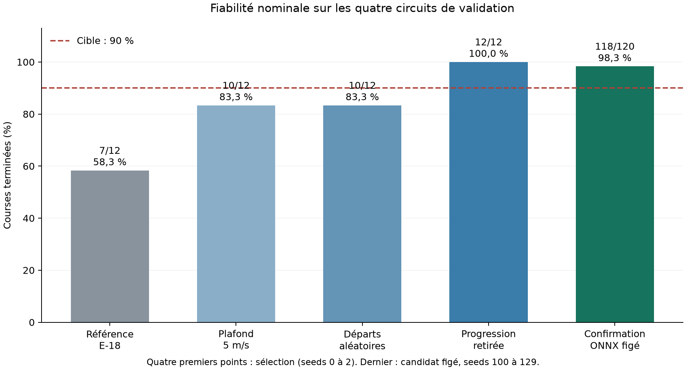

# E-19 : cible nominale de 90 % atteinte

Le pilote réactif livré dans `submission/driver1` termine **118/120 courses de
confirmation (98,3 %)** sur les quatre circuits de validation, en conditions
nominales. Il avait terminé les 12 courses utilisées pour la sélection. Les 120
courses suivantes utilisent des seeds nouvelles et l'agent ONNX figé, dans l'image
CPU officielle, depuis `/tmp`, sans importer PyTorch ni Stable-Baselines3.



## Mesure et sélection

Trois tours, départ officiel, 8000 décisions au plus. Tous les DNF et TIMEOUT
restent dans les effectifs. Le [protocole](../../reliability_e19.md) précède chaque
essai et le [gel du candidat](candidate-freeze.json) précède la confirmation.

| Essai | Courses finies | Utilisation |
|---|---:|---|
| Référence E-18, h1 seed 0 | 7/12 | Référence historique |
| Adaptation, plafond 5 m/s | 10/12 | Sélection |
| Même adaptation, départs train diversifiés | 10/12 | Sélection |
| Connexions de progression retirées | 12/12 | Candidat retenu |
| Agent ONNX figé, seeds 100 à 129 | 118/120 | Confirmation |

La comparaison multi-seeds de E-18 reste inchangée. L'adaptation présentée ici
utilise une seule seed d'entraînement, 0, depuis le meilleur réactif de cette
campagne. Les seeds 100 à 129 sont des seeds de course, pas 30 entraînements.
La mesure confirme la répétabilité sur les mêmes quatre cartes face au bruit
nominal ; elle ne prouve pas la généralisation à de nouvelles cartes. Le test
scellé n'a jamais servi à entraîner, choisir ou confirmer ce candidat.

| Circuit | Arrivées en confirmation | DNF |
|---|---:|---:|
| Montreal | 28/30 | 2 |
| Sochi | 30/30 | 0 |
| Spielberg | 30/30 | 0 |
| YasMarina | 30/30 | 0 |

Les DNF de Montreal concernent les seeds 104 et 118. Ils restent dans
[les 120 résultats bruts](candidate-onnx-confirmation.json).

## Ce qui a changé

On conserve PPO : cette chaîne avait déjà fini les 45 courses train de référence,
et ses checkpoints, sa reprise et son export étaient vérifiés. Changer aussi
d'algorithme aurait empêché d'isoler ces adaptations. Il n'y a pas de comparaison
PPO/SAC dans cette expérience.

Deux essais GPU demandent chacun deux millions d'interactions supplémentaires,
soit 2 027 520 après arrondi SB3, sur les quinze circuits train. Leurs poids
initiaux viennent du réactif seed 0 de E-18, déjà entraîné pendant 5 007 360
interactions. Le candidat hérite donc de 7 034 880 interactions, pas de la somme
des deux essais. Chaque essai repart avec un optimiseur neuf. Le second varie
les positions et les caps de départ. Reward v1, physique et features canoniques
restent inchangées. Le plafond de 5 m/s est stocké dans l'espace d'action du
modèle et reproduit dans le graphe ONNX.

Masquer la progression a donné 12/12 sur la sélection. La dérivation met seulement
à zéro les colonnes 102 à 104 dans la première couche de l'acteur et du critique.
Elle supprime la dépendance à la phase et au nombre de tours, sans ajouter
d'interactions ni remplacer la politique par un pilote scripté. Le manifest
conserve le hash source, la transformation et le contrôle d'équivalence sur 256
entrées. Le manifest d'entraînement original est aussi conservé.

## Chronos et limites restantes

La fiabilité est prioritaire : sur les sept mêmes courses finies par la référence
et le candidat, la médiane des temps sur trois tours passe de **120,65 s à
203,00 s**. Le plafond de vitesse coûte donc du temps. Ce choix ne vise pas
encore la performance du champion.

La campagne complémentaire PyTorch emploie le même checkpoint que l'export,
avec les 105 cas de E-18. Elle confirme 45/45 sur train et 12/12 sur validation
nominale. Ces 12 courses de validation répètent les cas de sélection ; elles
ne s'ajoutent pas à l'effectif indépendant de confirmation ONNX.

| Condition de validation | Arrivées |
|---|---:|
| Nominal | 12/12 |
| Faible adhérence | 6/12 |
| Bruit LiDAR | 12/12 |
| Forte pluie | 6/12 |
| Marge de sortie stricte, 0,50 m | 12/12 |

La cible atteinte est **nominale**. L'adhérence dégradée reste à traiter dans
E-23. Les [105 courses brutes](candidate-full-campaign.json) sont conservées.

## Artefact et preuves

Modèle dérivé :
`3af6a59fe7796c6f5711d5e799e0432e1c04fb6755e81762611a508e3830d8d6`.
La [preuve de livraison](submission-proof.json) relie ce modèle aux courses et
au [manifest dérivé](manifests/candidate-progress-blind.json).

- Vérificateur officiel : valide.
- ONNX contre PyTorch : écart maximal 4,77 × 10⁻⁷, sous 10⁻⁵, sur 256 entrées.
- Agent ONNX : 12/12 en sélection puis 118/120 en confirmation dans l'image CPU.
- Hashes du gel : identiques avant et après les 120 courses ; vitesse cible au
  plus 5 m/s ; trois temps de tour pour chaque arrivée.
- Ruff et format passent. 547 tests passent avec les tests longs ; les 472 tests
  par défaut repassent après installation du nouvel agent dans `submission/`.
- La [relecture Sol](review.md) sépare les approbations du code et les mesures.

`driver2` conserve le modèle historique de E-18. La page E-18 décrit toujours
les agents historiques au commit `779d61b`, dont l'ancien `driver1` à 7/12.

## Archive et reproduction

Archive durable : `/home/leo/runs/crashlearn/e19-20261110`. Elle contient les
deux entraînements complets, leurs checkpoints, CSV et W&B hors ligne, les
modèles source et dérivé, l'agent figé, les diagnostics et les sources figées.
Les commits d'entraînement sont `3a7da7e` et `9b3a9cc` ; la dérivation utilise
`cef4968`. Les versions et l'image GPU figurent dans chaque manifest.

Sur la station, depuis ce dépôt, avec les modèles archivés :

```bash
uv run python scripts/ablate_progress.py \
  --run-dir /home/leo/runs/crashlearn/e19-20261110/cap5-random-h1-seed0 \
  --output-dir runs/recheck-progress-blind
uv run python scripts/export_agent.py \
  --run-dir runs/recheck-progress-blind --output-dir runs/recheck-agent
```

Pour confirmer l'artefact livré, depuis la racine du dépôt :

```bash
docker run --rm --user "$(id -u):$(id -g)" \
  -v "$PWD:/workspace:ro" -v "$PWD/runs:/runs" -w /tmp \
  -e PYTHONPATH=/workspace/src -e NUMBA_CACHE_DIR=/runs/numba-cache-cpu \
  crashlearn-sim:20260918 python /workspace/scripts/confirm_submission.py \
  --submission /workspace/submission/driver1 \
  --output /runs/recheck-confirmation.json --seed-start 100 --seed-count 30
```

Le répertoire de sortie de dérivation et le fichier de confirmation doivent être
nouveaux : les commandes refusent d'écraser une mesure précédente.
